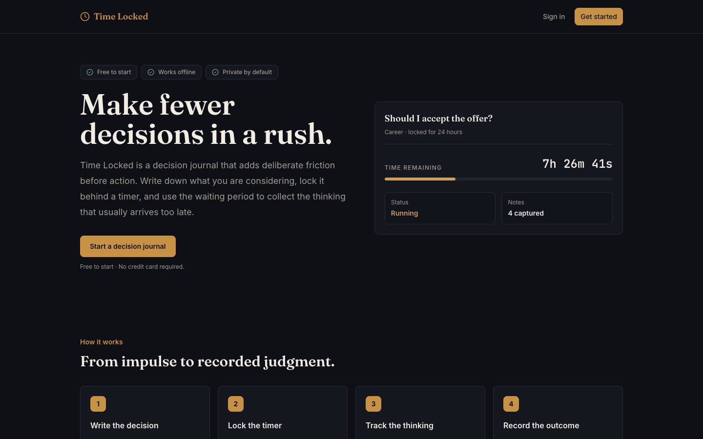

# Time Locked

A decision journal that adds deliberate friction before action. Write down a decision, lock it behind a timer, and use the waiting period to collect the thinking that usually arrives too late.

## What it does

1. **Write the decision** — capture the choice, the stakes, and why it feels urgent.
2. **Lock the timer** — pick a waiting period from one hour to one week.
3. **Track the thinking** — add notes whenever new concerns, tradeoffs, or ideas surface while the timer runs.
4. **Record the outcome** — when the lock opens, decide with context and keep a record of how your judgment evolved.

Along the way you can:

- Pause and resume a countdown without losing elapsed time
- Stop a decision you no longer need — it's archived, not deleted
- Tag decisions (Financial, Career, Health, Relationship, Personal, Work, or your own)
- Get a push notification when a timer expires, even with the app closed
- Browse past decisions in your history, filtered by status
- Install it on desktop or mobile as a PWA that works offline
